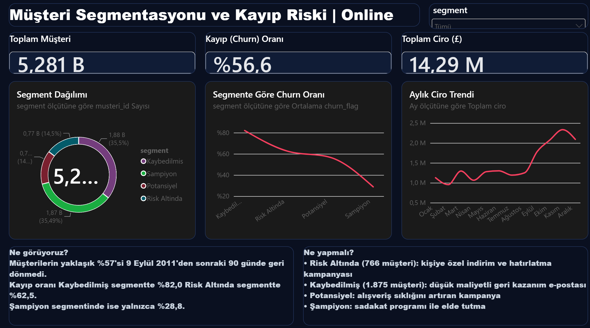
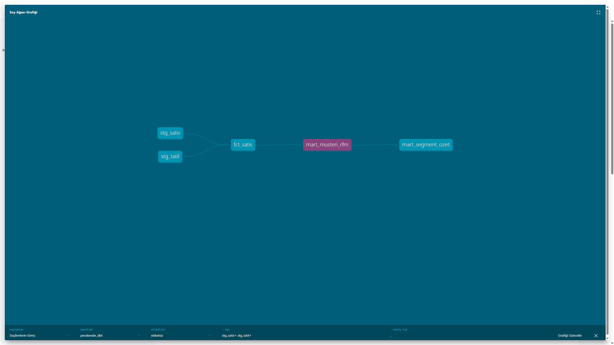

# Müşteri Segmentasyonu ve Kayıp (Churn) Riski Yönetimi

YBS305 İş Zekâsı ve Veri Madenciliği · Dönem Projesi · Bölüm 1
Grup üyeleri: (Alperen DİNÇ, Mustafa Selim KUVALİ, Yunus Emre DENİZ)

## İş sorusu
Online Retail II müşterilerini RFM davranışına göre segmentlere ayırarak,
önümüzdeki 90 günde alışveriş yapmama (kayıp) riski yüksek müşterileri tespit etmek
ve her segment için farklı bir elde tutma aksiyonu önermek.

## Churn (kayıp) tanımı
Perakendede abonelik olmadığı için kayıp davranıştan türetilir.
Takvim 9 Eylül 2011'de (kesme tarihi) dondurulur. O tarihe kadarki alışverişlerden
RFM hesaplanır. Müşteri, kesme tarihinden sonraki 90 gün içinde hiç alışveriş
yapmadıysa churn_flag = 1 olur. Bu yöntem, Bölüm 2'deki modelde veri sızıntısını önler.

## Veri kaynakları
1. **Online Retail II** (UCI Machine Learning Repository), Chen, D. (2012),
   CC BY 4.0. UK merkezli online perakendecinin 01.12.2009 - 09.12.2011 arası
   işlemleri. https://archive.ics.uci.edu/dataset/502/online+retail+ii
2. **UK resmi tatil takvimi** (dış kaynak), https://www.gov.uk/bank-holidays.json

## Veri temizleme kuralları (stg_satis)
Ham veride 1.067.371 satır vardı, temizlik sonrası 805.549 satır kaldı.
Atılanlar:
- Müşteri numarası boş satırlar (müşteri analizine girmez)
- İptal/iade faturaları (fatura numarası "C" ile başlar)
- Adedi 0 veya negatif satırlar
- Birim fiyatı 0 veya negatif satırlar

## Proje yapısı
- `data/` : ham veri ve dış kaynak dosyaları
- `dbt/models/staging/` : stg_satis, stg_tatil (temizleme)
- `dbt/models/marts/` : mart_musteri_rfm, mart_aylik_satis (analiz tabloları)
- `dbt/models/schema.yml`, `dbt/models/marts/schema_marts.yml`, `dbt/tests/` : dbt testleri (22 test)
- `scripts/prepare_data.py`, `scripts/prepare_tatil.py`, `scripts/export_mart.py` : veri hazırlama ve dışa aktarma
- `proje.pbix` : Power BI panosu
- `veri_sozlugu.md` : sütun açıklamaları
- `dbt/models/marts/fct_satis.sql`, `dim_musteri.sql`, `mart_segment_ozet.sql` : satış gerçek tablosu (resmi tatil bayrağıyla), müşteri boyut tablosu ve segment özet tablosu
- `notebooks/eda.ipynb` : keşifsel veri analizi (EDA)
- `model/model/churn_model.py` : churn tahmin modeli (Bölüm 2 başlangıcı)

## dbt Testleri
Projede toplam 22 test var:
- **19 genel (generic) test:** `not_null`, `unique`, `accepted_values` ve `relationships` (satışlardaki müşteri numaralarının müşteri tablosunda bulunması).
- **3 özel (singular) SQL testi** (`dbt/tests/`): segmentlerdeki müşteri toplamı RFM tablosuyla aynı mı, RFM değerleri geçerli mi, satır tutarları pozitif mi.

Çalıştırma: `cd dbt` ardından `dbt test --profiles-dir .`

## Çalıştırma
1. Python 3.12 kurun, sanal ortam açın ve dbt'yi kurun:
```
py -3.12 -m venv .venv
.venv\Scripts\Activate.ps1
python -m pip install dbt-duckdb pandas openpyxl duckdb requests
```
2. UCI sitesinden `online_retail_II.xlsx` dosyasını indirip `data/` içine koyun.
3. Verileri hazırlayın:
```
python scripts/prepare_data.py
python scripts/prepare_tatil.py
```
4. dbt modellerini çalıştırın ve test edin:
```
cd dbt
dbt run --profiles-dir .
dbt test --profiles-dir .
dbt docs generate --profiles-dir .
```
5. Power BI için tabloları dışa aktarın: `python ..\scripts/export_mart.py`
6. `proje.pbix` dosyasını Power BI Desktop ile açın.

## Dashboard


## dbt Akış Şeması
Veri, ham dosyalardan staging modellerine, oradan mart tablolarına akar.
Her modelin açıklaması ve testleri `dbt docs generate` ile üretilen dokümantasyonda görülebilir.



## Temel bulgular
- Analizdeki 5.281 müşterinin yaklaşık %57'si kesme tarihinden sonraki 90 günde geri dönmedi.
- Segmentlere göre churn oranı: Kaybedilmiş %82,0, Risk Altında %62,5,
  Potansiyel %56,7, Şampiyon %28,8.
- Öneri: Risk Altında segmentine kişiye özel kampanya, Kaybedilmiş segmentine
  düşük maliyetli geri kazanım e-postası, Şampiyonlara sadakat programı.

## Araç tercihleri
DuckDB (kurulumsuz yerel veri ambarı), dbt Core + dbt-duckdb (ETL ve test),
Power BI Desktop (görselleştirme), Parquet (Power BI'a aktarım, CSV'de Türkçe
ondalık ayracı sorun çıkarabildiği için).

## Sınırlılıklar
- Veri 2009-2011 dönemine ait ve tek bir şirkete ait.
- Müşterilerin çoğu bireysel değil toptancıdır.
- Müşteri numarası boş satırlar (yaklaşık %23) analiz dışında kalmıştır.
- Kişisel veri içermez, müşteriler yalnızca anonim numarayla temsil edilir (KVKK uyumu).

- 

## Sık Karşılaşılan Sorunlar (Windows)

- **`py` komutu bulunamıyor:** Python'u python.org'dan kurarken
  "Add python.exe to PATH" kutucuğunu işaretleyin, sonra VS Code'u kapatıp açın.
  Sürüm olarak Python 3.12 kullanın.
- **`Activate.ps1` çalıştırılamıyor ("running scripts is disabled"):**
  Terminale şunu yazın, sonra tekrar deneyin:
  `Set-ExecutionPolicy -Scope Process -ExecutionPolicy Bypass`
- **Excel dosyası repoda yok:** `online_retail_II.xlsx` dosyasını UCI sitesinden
  indirip `data/` klasörüne koyun, ardından `python scripts/prepare_data.py` çalıştırın.

Bu adımlar temiz bir Windows bilgisayarında repo baştan kurularak test edilmiştir.
`dbt run` ve `dbt test` hatasız çalışmıştır.

-

## Kaynakça

**Veri kaynakları**
- Chen, D. (2012). *Online Retail II* [Veri seti]. UCI Machine Learning Repository. https://doi.org/10.24432/C5CG6D (CC BY 4.0)
- HM Government. (t.y.). *UK bank holidays* [Veri seti]. GOV.UK. https://www.gov.uk/bank-holidays (Erişim: 1 Kasım 2026)

**Yöntem**
- Chen, D., Sain, S. L., & Guo, K. (2012). Data mining for the online retail industry: A case study of RFM model-based customer segmentation using data mining. *Journal of Database Marketing & Customer Strategy Management, 19*(3), 197-208.

**Araç dokümantasyonları**
- dbt Labs. (t.y.). *dbt documentation*. https://docs.getdbt.com
- DuckDB. (t.y.). *DuckDB documentation*. https://duckdb.org/docs
- Microsoft. (t.y.). *Power BI Desktop documentation*. https://learn.microsoft.com/power-bi/

**Yapay zekâ desteği**
- Bu projede kod yazımı ve adım adım açıklama için yapay zekâ asistanı (Claude, Anthropic) yardımcı olarak kullanılmıştır. Üretilen kodlar ekip tarafından çalıştırılmış ve test edilmiştir.

## Ekip ve Görev Dağılımı

Proje Google Meet üzerinden ortak yürütülmüştür. Üç üye de hattın adımlarını (veri hazırlama, dbt, dashboard) kendi bilgisayarında uygulayıp çalıştırarak doğrulamıştır. Kod GitHub'a ağırlıklı olarak repo sahibi hesabından gönderildiği için commit geçmişinde bu hesap öne çıkmaktadır. Sorumluluk alanları ekip içinde aşağıdaki gibi paylaşılmıştır.

| Üye | Öğrenci No | GitHub | Sorumluluk alanı |
|---|---|---|---|
| Mustafa Selim Kuvali | 030424021 | [mustafakuvali](https://github.com/mustafakuvali) | dbt hattı (7 model, 22 test, dbt docs), Power BI dashboard, repo yönetimi |
| Alperen Dinç | 030424037 | [alperendinc1453-collab](https://github.com/alperendinc1453-collab) | Model çalışması (`model/model/model/churn_model.py`, Bölüm 2 başlangıcı), README ve veri sözlüğü |
| Yunus Emre Deniz | 030424038 | [yunusedeniz3403](https://github.com/yunusedeniz3403) | Veri toplama ve hazırlama (Online Retail II, UK tatil takvimi), EDA notebook, temiz kurulum testi ve sorun giderme dokümantasyonu |
